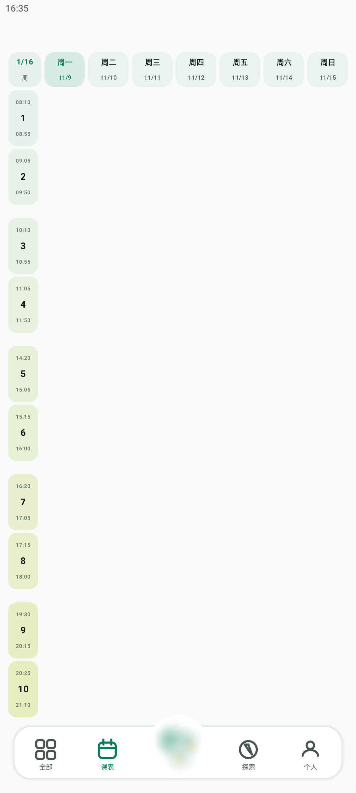

# 课表 第 1 步：「表格」布局（票 #15）验收记录

> 地图 #11「制作课程表」的第 1 步。只做布局骨架；课程卡片是第 2 步（#13）。
> 验收日期：2026-11-09 · 设备：BlueStacks API 33（1080×2400，density 420 ≈ 411dp）



## 交付内容

| 文件 | 说明 |
| --- | --- |
| `ui/timetable/TimetableGrid.kt` | 布局：节次时间列 + 星期表头 + 大课分组的格子槽位 |
| `ui/timetable/TimetableScreen.kt` | 容器：`uiScale`、状态栏与底栏避让、铺满可用区 |
| `ui/MainShell.kt` | 课表挂到第 2 个 Tab；实测底栏顶边回传给页面做避让 |

## 维护者的设计口径（两轮修订后定稿）

注意用词：这是**布局**，不是传统「表格」。

1. **顶部留白**抬高，给右上角 4 个按钮（设置 / 更新课表 / 切换日周 / 添加日程）留位置。
   本轮按维护者选择**只留空位、不画按钮**。
2. 左侧第一列加宽，每节显示「起始时间 / 节次号 / 结束时间」竖排，照抄旧农屿。
3. 上下左右都留出空隙。
4. **不画表格线，格子也不要底色** —— 右侧就是干净的背景，格子只是透明占位槽。
5. 今天的颜色很淡（只给日期盒子淡绿，不整列铺底）。
6. 星期日期与左侧时间列都改成**圆角矩形盒子**，彼此有间隔、不贴在一起；
   日期盒淡绿，时间列**淡绿 → 绿黄**渐变，且**一格一个纯色**。
7. 字体加粗。
8. **大课节奏**：1-2 / 3-4 / 5-6 / 7-8 / 9-10 各自靠近，
   **4↔5 与 8↔9 之间留大间隔**（午饭 / 晚饭）。

第 8 条与旧农屿 `courseTimes.ts` 的 `MAJOR_SLOT_COUNT = 5` / `slotIndexFromPeriod()` 完全一致，
所以直接沿用它的分组口径，没有另造一套。

## 节次作息（照抄旧农屿，勿改）

来源：`apps/nongyu-rn-app/src/modules/course/model/courseTimes.ts`（川农常见作息）

| 节次 | 起 | 止 | 节次 | 起 | 止 |
| --- | --- | --- | --- | --- | --- |
| 1 | 08:10 | 08:55 | 6 | 15:15 | 16:00 |
| 2 | 09:05 | 09:50 | 7 | 16:20 | 17:05 |
| 3 | 10:10 | 10:55 | 8 | 17:15 | 18:00 |
| 4 | 11:05 | 11:50 | 9 | 19:30 | 20:15 |
| 5 | 14:20 | 15:05 | 10 | 20:25 | 21:10 |

## 关键实现决定

### 表头与网格同基准（曾经踩过的坑）

表头行与网格行**都用**「固定 40dp 左侧列 + 7 × `weight(1f)`」。
表头左侧占位宽度必须与网格左侧列**完全相等**，不能写成「列宽 + 线宽」——
本项目曾因多补 0.5dp 而整体错位一位。

### 底部避让用实测值，不写死 dp

底部导航栏是自绘的（`MainShell.kt`，非 Scaffold）。它占的
= 竖直内边距 × 2 + 栏高 + 星云球凸起量，这些**全部乘了 `uiScale`**。
写死任何一个 dp 数，换屏宽就错，错了的表现就是「最下面一行被导航栏盖住」（需求 15）。

做法：Shell 用 `onGloballyPositioned` 上报底栏顶边的实测 y，页面据此给布局一个确定高度。
顺带修掉一处旧问题：底栏竖直内边距原写死 `18.dp`（未走 `s()`），大屏上比例失真，已改 `s(18.dp)`。

### 状态栏避让

`MainActivity` 开了 `enableEdgeToEdge()`，内容顶到屏幕最上沿。
第一版没扣状态栏，实测表头 `y=0..56` 被状态栏压住。现已按 `WindowInsets.statusBars` 下移。

## 实测验收（uiautomator 回读，不只看图）

| 检查项 | 实测 | 结论 |
| --- | --- | --- |
| 七天表头 | 周一…周日齐全 | ✅ |
| 节次 | 1..10 齐全，各有起止时刻 | ✅ |
| 大课组内间距 | 各节 y 起点差 ≈ 177/210px，组内相邻差 ≈ 51px | ✅ |
| 大课组间间距 | 4↔5 与 8↔9 处差 ≈ 162px | ✅ 明显大于组内 |
| 最下行不被导航栏遮 | 第 10 节底 `y=2110`，导航栏 `y=2306`，间隙 196px | ✅ |
| 时间列渐变 | `(231,242,238)` → `(231,238,190)` 淡绿→绿黄 | ✅ |
| 表格线 | 全屏零描边 | ✅ |
| 格子底色 | 无（透明占位） | ✅ |
| 启动不崩 | logcat 无 `FATAL EXCEPTION` | ✅ |

## 本步**没有**做的事（留给后续票，不要误当遗漏）

- **右上角 4 个按钮只留空位、未绘制**：维护者明确选择本步不画（属第 4 步 #14）。
- **当前周次固定 `1/16`**：学期起始日属数据模型口径，票 #12 未拍板前不臆造；
  已做成 `TimetableGrid(currentWeek = 1)` 参数。
- 左上角点击弹日历子窗体 → #18；滑动切周 / 日模式 / 空白处添加 → #18、#14。
- 格子内课程卡片 → #13，已预留 `cellContent(day, period)` 槽位，第 2 步不必改布局。

## 构建环境要点（本机实测，重要）

**必须用 JDK 17，不能用 JDK 21。** 用 jdk-21 会在 `JdkImageTransform` 稳定失败，
`jlink` 报 `Module jdk.internal.vm.ci not found`。
证据：既有成功产物 `jdkImage/release` 写着 `JAVA_VERSION="17"`；
改 `JAVA_HOME=jdk-17` 后同一命令 `BUILD SUCCESSFUL`。

> 仓库旧文档 `docs/research/build-0.0.1test.md` 与本条冲突，**以本条为准**。
> 详细排查过程已独立沉淀进个人知识库。

可复现命令（干净 `GRADLE_USER_HOME` 以避开 `~/.gradle/init.d` 与
`settings.gradle.kts` 的 `FAIL_ON_PROJECT_REPOS` 冲突）：

```powershell
$env:JAVA_HOME        = "C:\Program Files\Java\jdk-17"
$env:ANDROID_HOME     = "C:\Users\LENOVO\AppData\Local\Android\Sdk"
$env:GRADLE_USER_HOME = "C:\Users\LENOVO\AppData\Local\Temp\nongyu-gradle-home-wf11"
& "C:\Users\LENOVO\.gradle\wrapper\dists\gradle-9.4.1-bin\arn2x92ynaizyzdaamcbpbhtj\gradle-9.4.1\bin\gradle.bat" `
  :app:assembleDebug --offline --console=plain --no-daemon
```

`GRADLE_USER_HOME` 里要有已解压的 `native\` 目录（从默认 home 复制），
否则报 `Failed to load native library 'native-platform.dll'`。

## 蓝叠调试的两个坑

1. **截图**：`adb exec-out screencap -p > file.png` 经 PowerShell 重定向会被文本编码破坏成坏 PNG。
   改用两段式：`adb shell screencap -p /sdcard/x.png` + `adb pull`。
2. **`wm density` 会重置 size 覆盖**：改密度后 `wm size` 可能回落到物理 1920×1080，
   表现为界面变成横幅。改完密度要复核 `wm size`，必要时重新 `wm size 1080x2400`。
